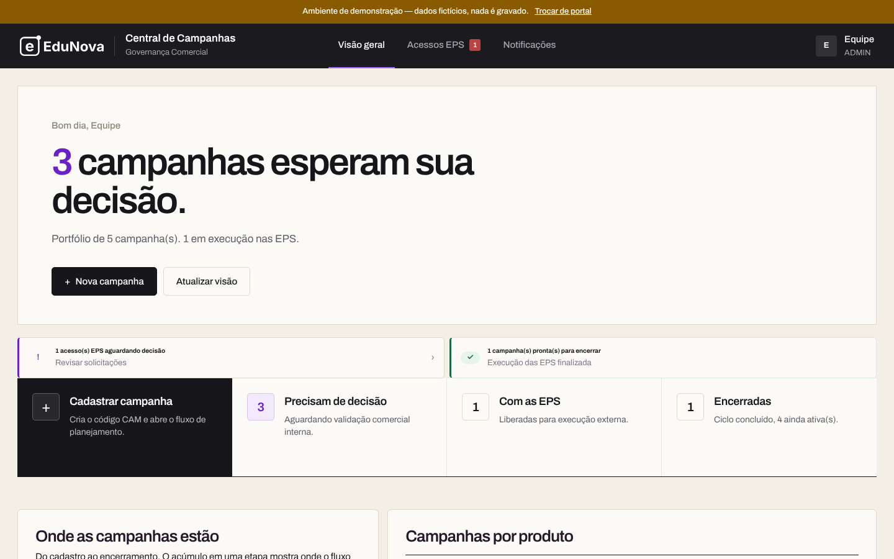
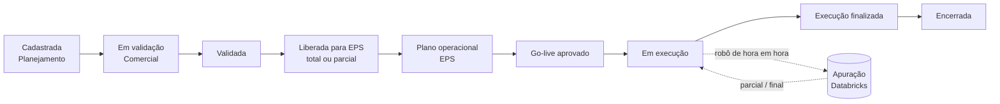

# Central de Campanhas

**Plataforma de governança de campanhas comerciais de contact center — do cadastro ao encerramento, com apuração automática de resultados no Databricks.**

[▶ Abrir a demonstração](https://datamur-solutions.github.io/central-campanhas/) · [Arquitetura](docs/arquitetura.md) · [Como os dados foram anonimizados](docs/anonimizacao.md)

> **Projeto de portfólio — [DataMur Solutions](https://github.com/datamur-solutions).**
> Construído para uma operação real de captação de alunos de um grupo educacional de grande porte.
> Nesta versão pública, a empresa ("EduNova"), os fornecedores ("Voxa", "Lumen", "Prisma"), as tabelas
> e todos os dados são **fictícios**. Nenhuma credencial, endereço interno ou informação real foi mantida.



---

## O problema

Uma operação de captação com vários fornecedores de call center (EPS) rodava campanhas comerciais em planilhas e e-mails:

- não havia um **dono claro** de cada etapa — quem cadastra, quem valida, quando a EPS pode começar;
- metas e escopo (produto, modalidade, canal, público) mudavam sem rastro;
- o **resultado de cada campanha** era apurado à mão, dias depois, cruzando mailing, discador e matrícula;
- ninguém conseguia responder rápido: *essa campanha funcionou? qual EPS converteu melhor?*

## A solução

Uma central única, com **dois portais** sobre o mesmo backend, e um **robô de apuração** que fecha o ciclo com os dados oficiais:

| Portal interno (Planejamento e Comercial) | Portal EPS (fornecedores) |
|---|---|
| Cadastro da campanha com código `CAM-NNN`, objetivo, KPIs e escopo | Recebe só as campanhas liberadas para ela |
| Validação comercial e liberação (total ou parcial) por EPS | Plano operacional, go-live e registro diário de execução |
| Aprovação de acessos dos operadores das EPS | Tabulações, evidências e fechamento da atuação |
| Painel de apuração: funil e matrículas por campanha × EPS | Acompanhamento das metas da campanha |



### Robô de apuração

Roda numa VM Windows, de hora em hora nos dias úteis, sem ninguém logado:

1. Pergunta à Central quais campanhas estão em apuração.
2. Confere se a base D-1 de cada produto já chegou no Databricks.
3. Lê os mailings novos (ação comercial) de um *volume* do Unity Catalog.
4. Apura **mailing × base** (ação comercial) ou **perfil × período** (incentivo), com regras por produto e por EPS.
5. Grava o resultado **parcial ou final** na Central — ou registra a pendência, que dispara alerta por e-mail.

## Destaques técnicos

- **Backend FastAPI** (Python 3.12): 50+ endpoints, validação com Pydantic, ~20 mil linhas organizadas em serviços por domínio (campanhas, EPS, apuração, notificações, auth).
- **Dois motores de dados atrás da mesma camada** (`app/db.py`): Postgres (Supabase) para a operação transacional e Databricks SQL para a base analítica — trocados por variável de ambiente.
- **Autenticação própria**: senha com PBKDF2, sessão assinada (HMAC) em cookie, perfis internos (ADMIN, PLANEJAMENTO, COMERCIAL) e portal separado para as EPS, fluxo de redefinição por token e acesso de fornecedor aprovado pelo time interno.
- **Segurança de borda**: trava de homologação (*basic auth* de perímetro), cabeçalhos de segurança, CORS restrito, documentação da API desligável.
- **Notificações** por e-mail transacional (Brevo) e fila com reprocessamento e arquivamento de erros.
- **Robô resiliente**: OAuth do Databricks com token persistido, chave guardada no cofre do Windows, modo `--simular`, reapuração após ajuste de regra e agendamento via `ScheduledTasks`.
- **Front-end sem framework**: HTML/CSS/JS puro, responsivo, ~16 mil linhas, com a mesma base de código servindo a demo estática.
- **Deploy** em Docker no Render, com *health check*.

## Stack

`Python` `FastAPI` `Pydantic` `PostgreSQL / Supabase` `Databricks SQL` `Unity Catalog` `Docker` `Render` `Brevo` `JavaScript` `HTML/CSS` `GitHub Actions`

## Estrutura

```
app/
├── main.py                    # rotas da API e dos portais
├── db.py                      # camada de dados: Postgres ou Databricks
├── models.py                  # contratos (Pydantic)
├── campaign_service.py        # ciclo de vida da campanha
├── external_service.py        # operação das EPS
├── robo_apuracao_service.py   # API consumida pelo robô
├── notification_service_*.py  # fila e envio de notificações
├── auth.py · sessao.py · senha_service.py · homolog_guard.py
├── robo_vm/                   # robô de apuração (roda fora do servidor)
│   ├── robo_apuracao.py
│   ├── regras_campanha.py     # regras de negócio por produto e EPS
│   └── paineis_eps.py         # conector de painéis de parceiros (omitido)
└── static/                    # portais interno e EPS
demo/                          # mesma interface, com dados fictícios no navegador
docs/                          # arquitetura e anonimização
```

## Rodando

**Demonstração (sem backend):** abra `demo/index.html` no navegador, ou acesse o [link publicado](https://datamur-solutions.github.io/central-campanhas/). Os dados ficam no próprio navegador e voltam ao estado inicial ao recarregar.

**Backend:**

```bash
cp .env.example .env          # preencha com os seus recursos
pip install -r requirements.txt
uvicorn app.main:app --reload
```

O backend precisa de um Postgres (ou Databricks SQL Warehouse) com as tabelas da aplicação. Esta versão pública não inclui dados.

## Sobre esta versão

O código foi copiado da versão em produção e passou por uma limpeza automatizada e revisada: marca, fornecedores, e-mails, endereços, nomes de tabelas e de máquinas foram substituídos, e os conectores de sistemas de terceiros foram retirados. Os detalhes estão em [docs/anonimizacao.md](docs/anonimizacao.md). Uma verificação de segredos (gitleaks) roda a cada push.

---

<sub>© DataMur Solutions. Código publicado para fins de portfólio — todos os direitos reservados.</sub>
