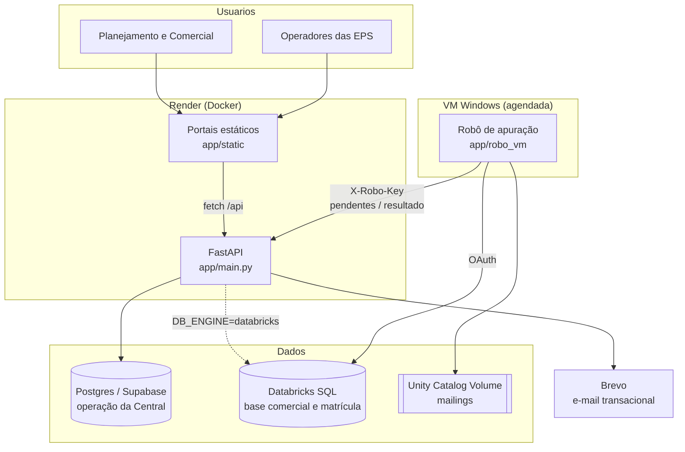

# Arquitetura

## Camadas

| Camada | Arquivos | Responsabilidade |
|---|---|---|
| Rotas | `main.py` | Endpoints da API, portais, middlewares de segurança e CORS |
| Contratos | `models.py` | Modelos Pydantic de entrada (campanha, escopo, KPIs, plano da EPS, go-live, monitoramento, fechamento) |
| Domínio | `campaign_service.py`, `external_service.py`, `atuacao_service.py`, `meta_eps_service.py`, `historico_service.py` | Ciclo de vida da campanha, operação da EPS, metas e trilha de auditoria |
| Painéis | `internal_dashboard_service.py`, `internal_monitoring_service.py` | Visão geral e acompanhamento do Planejamento |
| Apuração | `robo_apuracao_service.py`, `robo_notificacao_service.py` | API do robô, recebimento de resultados parciais/finais e alertas |
| Notificações | `notification_service_v7/v72/v8.py`, `email_service.py` | Fila, envio, reprocessamento e arquivamento |
| Acesso | `auth.py`, `external_auth.py`, `sessao.py`, `senha_service.py`, `homolog_guard.py` | Login interno e de EPS, sessão, senhas e trava de homologação |
| Dados | `db.py` | Conexão com Postgres (pool) ou Databricks SQL, com o mesmo `fetch_all` / `fetch_one` |

## Ciclo de vida da campanha

| Etapa | Quem age | Status |
|---|---|---|
| Cadastro, objetivo e KPIs | Planejamento | `CADASTRADA_PLANEJAMENTO` |
| Validação | Comercial | `EM_VALIDACAO_COMERCIAL` → `VALIDADA_COMERCIAL` |
| Liberação por EPS (total ou parcial) | Planejamento | `AGUARDANDO_PLANEJAMENTO_EPS` |
| Plano operacional | EPS | `PLANEJAMENTO_EPS` |
| Go-live | Planejamento | `GO_LIVE_APROVADO` |
| Execução e registro diário | EPS | `EM_EXECUCAO` |
| Fechamento da atuação | EPS | `EXECUCAO_FINALIZADA` |
| Encerramento | Planejamento | campanha encerrada |

Cada transição grava histórico (quem, quando, de qual status para qual) e pode disparar notificação.

## Regras de apuração (`robo_vm/regras_campanha.py`)

- **Ação comercial:** cruza o mailing da campanha com a base de interações e de matrícula, dentro da janela da campanha mais uma esteira de 15 dias para matrícula.
- **Incentivo:** apura por perfil (produto, modalidade, canal) × período, sem mailing.
- Funil padronizado por EPS: tentativas → trabalhados → alô → efetivo → vendas → matrículas.
- Calendário de dias úteis com feriados nacionais e emendas configuráveis.
- A matrícula vem **sempre** da base oficial no Databricks; painéis de parceiros servem só para conferência.
